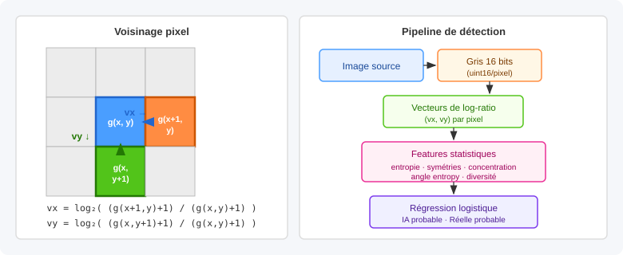

# detecteur_image_ia

Outil expérimental de détection d'images générées par IA, basé sur l'analyse
statistique des gradients locaux.

## Principe

L'approche repose sur le fait que les images générées par IA et les photographies
réelles présentent des signatures statistiques différentes au niveau des
transitions entre pixels voisins.

Pour chaque pixel, on calcule un vecteur de log-ratio avec ses voisins de droite
et du bas :

```text
vx = log2((g(x+1, y) + 1) / (g(x, y) + 1))
vy = log2((g(x, y+1) + 1) / (g(x, y) + 1))
```

Le `+1` évite les divisions par zéro. Les valeurs sont multipliées par
`1_000_000` et arrondies en `int32` pour garantir un calcul déterministe.



L'ensemble de ces vecteurs forme un **champ de vecteurs de log-ratio** dont
la distribution statistique (entropie, symétries, concentration, diversité)
diffère selon l'origine de l'image. Un modèle de régression logistique simple
apprend à distinguer ces signatures.

Le pipeline de traitement est :

```text
image → gris 16 bits → vecteurs de log-ratio → features statistiques → classification
```

## Formats de fichiers intermédiaires

- `*_source_pixels.npz` : pixels décodés de l'image d'origine
- `*_gray16.png` : PNG en niveaux de gris 16 bits (`uint16` par pixel)
- `*_vectors.npz` : champ de vecteurs (`vx`, `vy` en `int32`)
- `*_distribution.npz` : triplets `vx`, `vy`, `count` pour chaque vecteur distinct
- `*_vectors.png` : visualisation de la distribution (avec léger lissage de densité)

## Utilisation

Analyser une image :

```bash
python3 scripts/analyze_image.py image_entree.png sortie --plot-size 1024
```

Analyser toutes les images d'un dossier :

```bash
python3 scripts/analyze_directory.py images/ resultats/ --plot-size 1024
```

Vue zoomée sur la distribution centrale :

```bash
python3 scripts/analyze_directory.py images/ resultats/ --plot-size 1024 --percentile 99.5
```

## Détection

Classer une image ou un dossier :

```bash
python3 scripts/detect.py images/ --csv resultats/predictions.csv
```

Classer et copier les images dans deux dossiers de contrôle :

```bash
python3 scripts/detect.py images/ \
  --csv resultats/predictions.csv \
  --copy-to resultats/controle
```

Cela crée :

- `resultats/controle/image_ia_probable/`
- `resultats/controle/image_reelle_probable/`

Afficher les features statistiques :

```bash
python3 scripts/detect.py images/ --show-features
```

## Entraînement

Réentraîner le modèle avec des images labellisées :

```bash
python3 scripts/train_detector.py models/current_detector.json \
  --fake-dir images_ia/ \
  --real-dir images_reelles/
```

Ou avec des motifs de fichiers :

```bash
python3 scripts/train_detector.py models/current_detector.json \
  --fake-pattern 'images_ia/*.png' \
  --real-pattern 'images_reelles/*.jpg'
```

Le détecteur n'utilise ni le nom de fichier, ni l'extension, ni les métadonnées.
Il reste provisoire : il faudra le réentraîner et le valider avec un jeu plus
grand et plus varié.

## Modèles

- `models/current_detector.json` : modèle courant (régression logistique sur
  features statistiques des vecteurs de log-ratio)
- `models/covariance_detector.json` : variante basée uniquement sur la covariance,
  conservée pour comparaison
